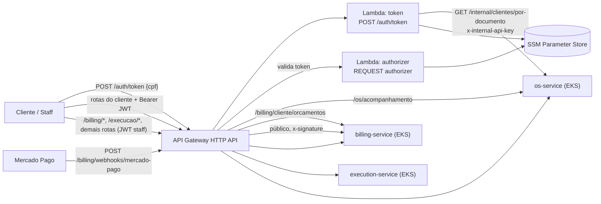

# tc-oficina-lambda-auth

Borda do sistema da oficina mecânica — Tech Challenge FIAP SOAT, grupo **Integradores**.
API Gateway HTTP API na frente dos microsserviços (`os-service`, `billing-service`,
`execution-service`) e duas funções AWS Lambda (Node.js 22): uma emite o JWT de cliente a
partir do CPF, a outra atua como Lambda Authorizer nas rotas sensíveis do cliente.

## Propósito ✱

O cliente se autentica pelo CPF: a Lambda `token` consulta o `os-service` (endpoint interno
`GET /internal/clientes/por-documento/:documento`, protegido por `x-internal-api-key`),
confere se o cliente existe e está **ativo** e devolve um JWT de curta duração (HS256,
expiração de 1h, claim `type: "cliente"`). A Lambda não acessa banco de dados: cada
microsserviço é dono do próprio banco.

O token é exigido pelo API Gateway — via Lambda `authorizer` — nas rotas sensíveis do
cliente (acompanhamento da OS e aprovação/rejeição de orçamento). Usuários internos
(atendente, mecânico, estoquista, administrador) autenticam no `os-service` e cada serviço
valida o JWT de staff localmente.

## Tecnologias ✱

- Node.js 22 + TypeScript (`fetch` nativo para chamar o `os-service`)
- AWS Lambda (runtime `nodejs22.x`, role `LabRole`, sem VPC)
- API Gateway HTTP API (`AWS::ApiGatewayV2`), Lambda Authorizer do tipo `REQUEST` (cache 300s)
- `jsonwebtoken` (HS256), AWS SDK v3 (SSM)
- Terraform (backend S3 com `use_lockfile`), provider `hashicorp/aws`, `terraform test` com providers simulados
- esbuild (bundle) + zip para empacotar
- Jest (CPF, cliente HTTP do `os-service`, handlers `token` e `authorizer`)
- GitHub Actions — CI (`npm test`, build, `terraform validate` + `terraform test`) e CD (`terraform apply` por ambiente + smoke test)

## Arquitetura deste repositório ✱



### Rotas do API Gateway

Definidas em `terraform/gateway.tf`. O gateway não reescreve path: cada serviço recebe o
mesmo path da rota. Todas as integrações de proxy, exceto o webhook, propagam
`x-request-id` (`$context.requestId`) para correlação de logs.

| Rota | Destino | Autenticação |
| --- | --- | --- |
| `POST /auth/token` | Lambda `token` | pública |
| `GET /os/acompanhamento/{numero}` | `os-service` | authorizer `cliente-jwt` |
| `GET /billing/cliente/orcamentos/{numeroOs}` | `billing-service` | authorizer `cliente-jwt` |
| `POST /billing/cliente/orcamentos/{numeroOs}/aprovar` | `billing-service` | authorizer `cliente-jwt` |
| `POST /billing/cliente/orcamentos/{numeroOs}/rejeitar` | `billing-service` | authorizer `cliente-jwt` |
| `POST /billing/webhooks/mercado-pago` | `billing-service` | pública; assinatura `x-signature` validada pelo billing |
| `ANY /billing/{proxy+}` | `billing-service` | JWT de staff validado pelo serviço |
| `ANY /execucao/{proxy+}` | `execution-service` | JWT de staff validado pelo serviço |
| `ANY /internal/{proxy+}` | bloqueada | `AWS_IAM` — sem assinatura IAM o gateway responde `403` |
| `ANY /{proxy+}` | `os-service` | JWT de staff validado pelo serviço |

O HTTP API escolhe a rota mais específica, então as rotas explícitas do cliente e do webhook
têm precedência sobre `ANY /billing/{proxy+}`. O authorizer lê `Authorization: Bearer <token>`,
valida a assinatura HS256 e exige `type: "cliente"` — token de staff não passa nas rotas do
cliente. As rotas de `billing-service` e `execution-service` só são criadas depois que o
hostname do serviço é publicado no SSM (output `servicos_roteados` do Terraform mostra quais
estão ativos).

A integração do webhook não recebe o `x-request-id` do gateway porque o `x-request-id`
enviado pelo Mercado Pago faz parte do manifesto assinado em `x-signature`.

Documentação arquitetural completa (componentes, sequências, ADRs):
[`docs/arquitetura/`](https://github.com/FIAP-POS-TECH-SOFTWARE-ARCHITECTURE/tc-oficina-os-service/tree/main/docs/arquitetura)
no `tc-oficina-os-service`.

### Contrato do endpoint de token

**`POST /auth/token`** — corpo `{ "cpf": "12345678901" }` (aceita com ou sem máscara).

| Situação | Status | Body |
| --- | --- | --- |
| CPF válido, cliente ativo | `200` | `{ "token": "<jwt>", "expiresIn": 3600 }` |
| Body ausente/inválido ou CPF malformado | `400` | `{ "message": "CPF inválido" }` |
| CPF inexistente na base, ou cliente inativo | `401` | `{ "message": "Não autorizado" }` |
| `os-service` indisponível, lento (> 3s) ou resposta inesperada | `503` | `{ "message": "Serviço indisponível" }` |

O `401` é intencionalmente genérico: não diferencia "CPF não existe" de "cliente inativo".
Payload do JWT: `{ sub, nome, cpf, type: "cliente" }`.

### Parâmetros SSM consumidos

| Parâmetro SSM | Usado por | Descrição |
| --- | --- | --- |
| `/oficina/<env>/jwt-secret` | `token`, `authorizer` (runtime, cache por container) | segredo HS256 do JWT |
| `/oficina/<env>/internal-api-key` | `token` (runtime, cache por container) | valor do header `x-internal-api-key` para o `os-service` |
| `/oficina/<env>/os-service-lb-hostname` | Terraform | destino do catch-all, de `/os/acompanhamento` e da env `OS_SERVICE_URL` da Lambda `token` (obrigatório) |
| `/oficina/<env>/billing-service-lb-hostname` | Terraform | destino das rotas `/billing/*` (opcional até o deploy do billing) |
| `/oficina/<env>/execution-service-lb-hostname` | Terraform | destino de `/execucao/*` (opcional até o deploy do execution) |

Segredos e `internal-api-key` são provisionados por `tc-oficina-infra-db`; os hostnames, pelo
CD de cada serviço.

### Trade-offs

- A Lambda roda fora da VPC e chama o load balancer público do `os-service` por HTTP: a API
  key interna trafega sem TLS (conta AWS Academy sem domínio/certificado). Mitigação: a
  chave só dá acesso de leitura a cliente por documento e ao catálogo, fica no SSM e pode ser
  rotacionada; `/internal/*` é bloqueado no gateway.
- Hostnames dos load balancers são lidos no `terraform apply`. Se um Service for recriado
  (hostname novo), é preciso rodar o CD deste repositório de novo — ele atualiza as
  integrações e a env var da Lambda de uma vez.

## Como executar localmente ✱

Pré-requisitos: Node.js 22, `npm`, Terraform 1.15.

```bash
npm ci
npm test          # cpf, cliente do os-service (200/404/5xx/timeout/formato), token, authorizer
npm run build     # esbuild -> dist/
npm run package   # build + zip (dist -> lambda.zip), usado pelo terraform

terraform -chdir=terraform init -backend=false
terraform -chdir=terraform test   # rotas do gateway com providers simulados, sem conta AWS
```

Fluxo ponta a ponta do cliente (ambiente com os serviços deployados):

```bash
API=<api_endpoint>
TOKEN=$(curl -s -X POST "$API/auth/token" -H 'content-type: application/json' \
  -d '{"cpf":"<cpf de cliente ativo>"}' | jq -r .token)
curl -s -o /dev/null -w '%{http_code}\n' "$API/os/acompanhamento/<numeroOs>"        # 401 sem token
curl -s -H "Authorization: Bearer $TOKEN" "$API/os/acompanhamento/<numeroOs>"         # 200
curl -s -H "Authorization: Bearer $TOKEN" "$API/billing/cliente/orcamentos/<numeroOs>" # orçamento
curl -s -X POST -H "Authorization: Bearer $TOKEN" \
  "$API/billing/cliente/orcamentos/<numeroOs>/aprovar"                                # linkPagamento
```

## Deploy ✱

Automático via GitHub Actions (`.github/workflows/cd.yml`), também disparável manualmente
(`workflow_dispatch`):

- push/merge em `develop` → `terraform apply` no ambiente `homolog`.
- push/merge em `main` → `terraform apply` no ambiente `prod`.

O workflow roda `npm test` + `npm run build`, garante o bucket S3 de `tfstate`, aplica o
Terraform (backend S3 key `fase-3/lambda-auth-<environment>.tfstate`) e faz smoke test:
token com CPF malformado (`400`), endpoint interno do `os-service` sem chave (`401`) e com a
chave do SSM (`404` para CPF sem cadastro), token com CPF sem cadastro (`401`), rota de
cliente sem token (`401`) e `/internal` pelo gateway (`403`).

**Ordem:** este repositório deve ser aplicado **depois** do deploy dos serviços (os
hostnames precisam existir no SSM). Depois do primeiro deploy do `billing-service` ou do
`execution-service`, ou de qualquer recriação de Service, rodar de novo:

```bash
gh workflow run cd.yml --ref develop   # homolog
gh workflow run cd.yml --ref main      # prod
```

Secrets necessários: `AWS_ACCESS_KEY_ID`, `AWS_SECRET_ACCESS_KEY`, `AWS_SESSION_TOKEN`
(Learner Lab, rotativos). Deploy manual de contingência:

```bash
npm ci && npm run build
cd terraform
terraform init -backend-config="key=fase-3/lambda-auth-<homolog|prod>.tfstate"
terraform apply -var "environment=<homolog|prod>"
```

## Links ✱

- **Deploy ativo:** URL do API Gateway = output `api_endpoint` do `terraform apply` (conta
  AWS Academy — disponível sob demanda, com o lab ligado).
- **Swagger:** não se aplica a este repositório (Lambdas atrás do API Gateway). Cada
  microsserviço publica o próprio Swagger.
- **Collection Bruno / Postman:** [`bruno/Auth-CPF`](bruno/Auth-CPF) (abrir com
  [Bruno](https://www.usebruno.com/downloads) via **Open Collection**, escolher o ambiente
  **Homolog**/**Prod**, preencher `gatewayUrl`, `cpf` e `osNumero`, rodar na ordem
  `Auth > Emitir Token (CPF)` → `Rotas Protegidas` → `Borda`) · export equivalente:
  [`bruno/auth-cpf.postman_collection.json`](bruno/auth-cpf.postman_collection.json).
- **Demais repositórios da solução:**
  [`tc-oficina-os-service`](https://github.com/FIAP-POS-TECH-SOFTWARE-ARCHITECTURE/tc-oficina-os-service) ·
  [`tc-oficina-billing-service`](https://github.com/FIAP-POS-TECH-SOFTWARE-ARCHITECTURE/tc-oficina-billing-service) ·
  [`tc-oficina-execution-service`](https://github.com/FIAP-POS-TECH-SOFTWARE-ARCHITECTURE/tc-oficina-execution-service) ·
  [`tc-oficina-infra-k8s`](https://github.com/FIAP-POS-TECH-SOFTWARE-ARCHITECTURE/tc-oficina-infra-k8s) ·
  [`tc-oficina-infra-db`](https://github.com/FIAP-POS-TECH-SOFTWARE-ARCHITECTURE/tc-oficina-infra-db)
